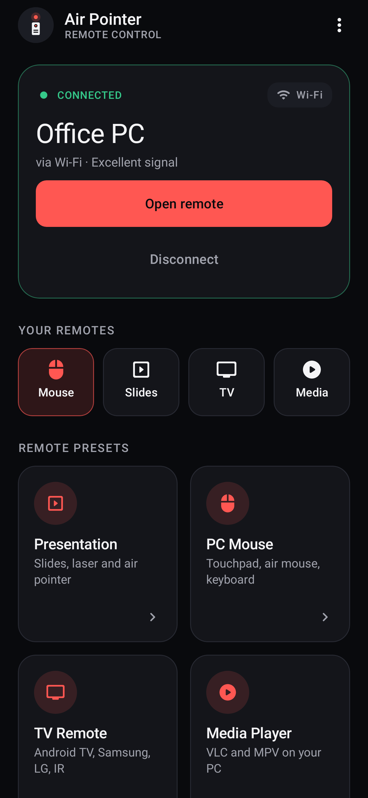
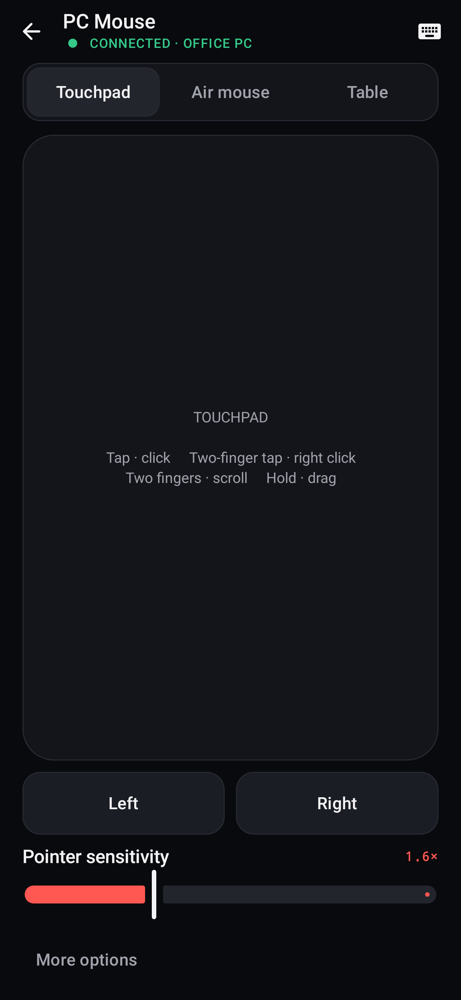
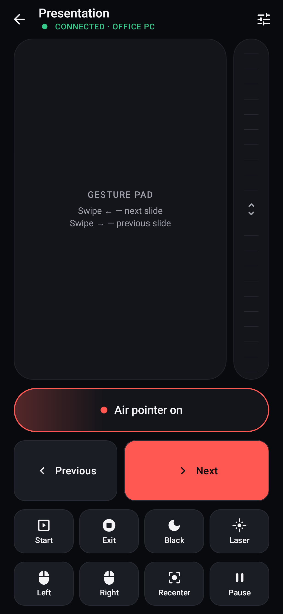
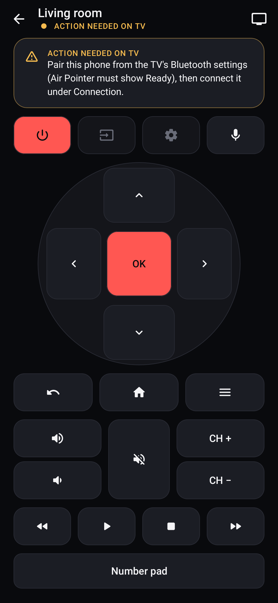

# Air Pointer — Remote Control Center for Android

Air Pointer turns an Android phone into four remotes, each built on the real protocol of the
device it controls:

| Preset | What it controls | How it talks |
|---|---|---|
| 1 · **Presentation** | PowerPoint, Keynote, Google Slides, PDFs | Bluetooth HID *or* Wi-Fi companion |
| 2 · **PC Mouse** | Windows / Linux cursor: **air mouse**, **touchpad**, **table mouse** (camera) | Bluetooth HID *or* Wi-Fi companion |
| 3 · **TV Remote** | Android TV / Google TV, Samsung, LG, any TV over IR or Bluetooth | Each TV's own protocol (see §5) |
| 4 · **Media Player** | VLC and MPV on the PC | VLC web interface; MPV JSON IPC through the companion |

Native Kotlin + Jetpack Compose. The app needs Android 9 (API 28) or newer. The desktop
companion is a single dependency-free Go binary for Windows and Linux.

---

## UI

<p>
 
 
</p>

These are real renders of the app's Compose UI (Robolectric native graphics + Roborazzi); the
"connected" screens come from a live Wi-Fi connection to the companion. To regenerate them:
`./gradlew testDebugUnitTest --tests '*Screenshots*' -Pscreenshots` (PNGs land in
`app/build/screenshots/`). For the connected screens, set
`AIRPOINTER_SCREENSHOT_COMPANION=host:port:pin` with a companion running.

* **Design system** (`ui/theme`, `ui/components/DesignSystem.kt`):
  * Palette `#090A0D / #14151A / #1B1D24 / #272932`, coral `#FF5752`, green `#35C98A`,
    yellow `#F5BB4F`; 8dp spacing scale; radii 12 (buttons) / 20 (cards) / 24 (connection card).
  * Components: AppHeader, ConnectionCard, StatusIndicator, RemoteCard, SectionHeader,
    SetupItem, PrimaryButton, IconContainer, RemoteToolbar, NotificationBanner.
* **Contrast:** primary and secondary text are ≥ 6.6:1 on every surface. The muted grey
  (3.5:1) is used only for disabled and decorative elements, never for readable text. Labels on
  coral buttons are near-black (6.4:1), because white would be 3.1:1.
* **Connection management:** one card maps the Bluetooth/Wi-Fi state onto a single state, each
  with its recovery action. `connectionCardState` is a pure function, unit-tested state by state:
  * connected (computer name, method, signal from Wi-Fi round-trip time)
  * connecting, not connected, not set up
  * connection lost, pairing failed
  * Bluetooth off, permission needed, Wi-Fi unavailable, unsupported phone, service stopped

  `LinkMonitor` tells a lost connection from a deliberate disconnect and drives the
  "Connection lost → Reconnect" banner on every screen. A remote that needs the PC, tapped while
  disconnected, explains why and offers **Connect now**; the remote opens automatically once
  connected. *Your remotes* (quick access) appears when connected and highlights the last-used
  remote.
* **Accessibility:**
  * every icon-only key has a spoken label and a Button role;
  * custom press handlers are activatable with TalkBack;
  * touch targets are at least 48dp;
  * status always pairs colour with text;
  * buttons use minimum (not fixed) heights, so system font scaling grows them instead of clipping;
  * headings are marked for screen-reader navigation.

---

## 1. Build

### Android app
Requirements: JDK 17+, Android SDK Platform 35 + Build-Tools 35 (Android Studio Ladybug or newer).

```bash
cd AirPointer
echo "sdk.dir=/path/to/Android/sdk" > local.properties
./gradlew testDebugUnitTest   # 98 JVM tests; 2 of them need live players and skip otherwise (§8)
./gradlew assembleRelease     # app/build/outputs/apk/release/app-release.apk (R8, ~3 MB)
./gradlew lintDebug
adb install -r app/build/outputs/apk/release/app-release.apk
```
Or open the `AirPointer/` folder in Android Studio and press **Run**. The release build is
signed with the debug key so it installs directly. Use your own keystore before distributing.

### Desktop companion (Wi-Fi mode, MPV control)
Requirements: Go 1.22+. No other dependencies.

```bash
cd AirPointer/companion
go test ./...
GOOS=windows GOARCH=amd64 go build -trimpath -ldflags "-s -w" -o ../dist/AirPointerCompanion-windows-amd64.exe .
GOOS=linux   GOARCH=amd64 go build -trimpath -ldflags "-s -w" -o ../dist/airpointer-companion-linux-amd64 .
GOOS=linux   GOARCH=arm64 go build -trimpath -ldflags "-s -w" -o ../dist/airpointer-companion-linux-arm64 .
```

Prebuilt files are in `dist/`: `AirPointer-2.1.1.apk` and the three companion binaries.

---

## 2. Choosing the PC connection: Bluetooth or Wi-Fi

*Home → Connection* switches between the two for the Presentation and PC Mouse presets.

| | Bluetooth HID | Wi-Fi companion |
|---|---|---|
| Software on the PC | none: the phone is a Bluetooth mouse + keyboard | `AirPointerCompanion` running |
| Phone requirement | firmware must support the HID Device profile (not all do) | any phone |
| Report rate | 60 Hz (HID link budget, configurable) | 125 Hz |
| Extra | works with TVs that accept Bluetooth keyboards | MPV control, latency readout |

### Wi-Fi setup
1. Run the companion on the PC:
   * **Windows:** double-click `AirPointerCompanion-windows-amd64.exe` and allow it through the
     firewall on *Private* networks.
   * **Linux:** `chmod +x airpointer-companion-linux-amd64 && ./airpointer-companion-linux-amd64`.
2. The window shows the PC's address and a **6-digit PIN**. The PIN is saved, so you pair once.
   Run with `-new-pin` to revoke all phones.
3. On the phone: *Connection → Wi-Fi → Scan*, pick the computer, enter the PIN. If discovery is
   blocked (some routers drop broadcasts), type the address shown in the companion window.

**Linux permissions.** Input is injected through `/dev/uinput`, so it works on both X11 and
Wayland. Either run the companion with `sudo`, or allow your user once:
```bash
echo 'KERNEL=="uinput", GROUP="input", MODE="0660", OPTIONS+="static_node=uinput"' | sudo tee /etc/udev/rules.d/60-airpointer.rules
sudo usermod -aG input $USER && sudo udevadm control --reload-rules && sudo modprobe uinput   # then log out and back in
```
Without that permission the companion runs in **media-only** mode: MPV control still works, and
the app tells you mouse and keyboard input are unavailable.

**Security.** Pairing proves knowledge of the PIN with HMAC-SHA256 over a fresh random nonce,
so the PIN never crosses the network. Traffic is not encrypted. Use it on your own network,
not on public Wi-Fi.

**Windows note.** Like any app that uses `SendInput`, the companion cannot control windows that
run as administrator unless it runs as administrator too.

### Bluetooth setup (no PC software)
1. Wait for **Ready** on the home screen. *Connection → Bluetooth → Make visible.*
2. On Windows: *Settings → Bluetooth & devices → Add device → Bluetooth*, pick the phone and
   confirm the code on both screens.
3. **Re-pair after updating from 1.x.** The HID descriptor gained a media-key collection in 2.0.
   Windows caches the old descriptor, so remove the phone on the PC (and the PC on the phone)
   and pair again.

---

## 3. Preset 1 · Presentation
Unchanged from 1.x: air pointer, next/previous (arrows or PgUp/PgDn), left/right click, pointer
button (toggle or hold), recenter, pause, black/white screen, start/end slideshow, PowerPoint
laser mode (Ctrl+L / Ctrl+A), configurable gesture pad, scroll strip, volume keys, and slide
controls in the notification.

---

## 4. Preset 2 · PC Mouse

### A. Air mouse: hand tracking with the camera
The cursor follows your **index finger in the air**, and every click is a **finger gesture in the
air**. Nothing is touched on the phone.

* Tracking uses Google's **MediaPipe Hand Landmarker** (21 hand points per frame). It runs
  entirely on the phone with the bundled `hand_landmarker.task` model, so no images leave the
  phone. The screen draws only the hand skeleton.
* `HandGestureMouse` (pure Kotlin, 9 unit tests) turns landmarks into mouse actions:

  | Gesture in the air | Action |
  |---|---|
  | move your hand / index finger | cursor moves (smoothing, dead zone, acceleration) |
  | pinch thumb + index | left click; two pinches = double click |
  | pinch thumb + index and hold (≥ 0.4 s) | drag; open the pinch to drop |
  | pinch thumb + middle | right click |
  | raise index + middle (✌) and move up/down | scroll |
  | fist | pause: reposition your hand without moving the cursor |

* **Click accuracy:**
  * The cursor follows the index finger's base knuckle by default. The knuckle stays still when
    you pinch, so a click lands where you pointed. Fingertip mode is optional.
  * The cursor is also frozen for the moment of a click.
* **Reliability:** pinches use hand-size-relative distances, so they work at any distance. They
  also use hysteresis, a 2-frame confirmation, and "the thumb must be clearly nearer to one
  finger", which stops a middle-finger pinch registering as a left click.
* **Setup:** prop the phone up facing you (or lay it flat with your hand above it), 30–60 cm
  away, in decent light. Front or back camera; invert X/Y if needed.
* The gyroscope air pointer is still used by the Presentation remote.

### B. Table mouse: gyroscope + accelerometer
The phone lies flat on the desk and is slid like a mouse; the screen is the mouse-button surface.

* **Why this is harder than it sounds.** These sensors measure acceleration, not position.
  Position needs integrating twice, and done naively it drifts away within a second.
  `TableMotionProcessor` keeps it in check with **zero-velocity updates (ZUPT)**, the technique
  inertial foot trackers use:
  * the gyroscope keeps the rest vector (gravity + accelerometer bias) aligned while the phone
    turns on the desk, and together with the accelerometer it detects rest;
  * at rest, velocity is reset to exactly zero and the bias is re-learned, so each push is
    integrated on its own and errors cannot build up;
  * a small dead band and a velocity leak suppress noise mid-stroke.
* Unit-tested (6 tests):
  * a 2 cm push gives the expected cursor travel in the right direction;
  * push-and-return ends near the start;
  * 10 s at rest with sensor bias and noise doesn't drift;
  * spinning the phone in place doesn't move the cursor;
  * repeated pushes add up.
* **Clicks on the screen:**
  * tap = left click (double tap = double click);
  * two-finger tap = right click;
  * two-finger drag = scroll;
  * tap then hold = drag.

  Phone motion is ignored while a finger is down, because a tap shakes the phone, except during
  a drag.
* **Expect:** short, brisk pushes work well, like a low-DPI mouse you lift and reposition. Very
  slow glides below the dead band register less. Keep the top of the phone pointing away from you.

### C. Touchpad
A laptop-style touchpad on the screen:
* one finger moves the pointer, with acceleration;
* **tap = left click**, **two-finger tap = right click**;
* **two-finger drag = scroll** (natural direction by default, switchable);
* **long press = drag mode**: the left button is held until you lift.

The logic lives in `TouchpadGestureEngine` and is unit-tested. The gyroscope is paused while the
touchpad or table mode is open, so the two don't fight.

---

## 5. Preset 3 · TV Remote

The app never assumes TVs share a protocol. Each connection type declares exactly which keys it
supports; unsupported keys are greyed out, and a "Limitations" panel explains why.

| Connection | Protocol actually implemented | Pairing |
|---|---|---|
| **Android TV / Google TV** (Sony, TCL, Hisense, Philips, Xiaomi, Chromecast with Google TV…) | *Android TV Remote Service v2*, the protocol Google's own TV remote uses: TLS with a client certificate kept in the Android Keystore; pairing on port 6467 (PairingRequest → Options → Configuration → Secret = SHA-256 of both RSA keys + code); remote on port 6466 (RemoteConfigure / SetActive / ping answers, `RemoteKeyInject` with Android key codes). Hand-written protobuf encoder, unit-tested. | 6-character code shown on the TV, entered once |
| **Samsung** Tizen (2016+) | WebSocket `wss://TV:8002/api/v2/channels/samsung.remote.control`, `SendRemoteKey` commands, `SendInputString` for text; Wake-on-LAN using the MAC from `http://TV:8001/api/v2/` | Accept "Air Pointer" on the TV; the token is saved |
| **LG** webOS (2014+) | SSAP over WebSocket (`wss://TV:3001`, falls back to `ws://TV:3000`): `register` with PROMPT pairing, `ssap://audio/…`, `ssap://tv/channel…`, `ssap://media.controls/…`, `ssap://system/turnOff`; arrows, OK, Back, Home and digits through the **pointer input socket**; text through `ssap://com.webos.service.ime/insertText`; Wake-on-LAN | Accept on the TV; the client key is saved |
| **Infrared** (any TV) | `ConsumerIrManager` with NEC (LG, generic), Samsung32 and Sony SIRC-12 encoders; timings are unit-tested bit by bit | Choose the brand's code set |
| **Bluetooth keyboard** | The phone's own HID keyboard + consumer-control (media key) collections: arrows, Enter, digits, Vol±, Mute, Ch±, Play/Pause, **AC Home**, **AC Back**, Menu, Power | Pair the phone from the TV's Bluetooth / accessories menu |

**Discovery:** mDNS `_androidtvremote2._tcp` finds Android TV / Google TV; SSDP M-SEARCH finds
Samsung (`RemoteControlReceiver`, server "Samsung/Tizen") and LG (`webos-second-screen`). Any TV
can also be added by IP address. TVs are saved, and you can switch between them under *TVs*.

**Certificate pinning:** TVs only offer self-signed certificates, so the app pins the
certificate it sees at first pairing (SHA-256, trust on first use). Later connections presenting
a different certificate are refused.

**Voice:**
* Samsung and LG: the phone's speech recogniser turns speech into text and types it into the
  TV's focused text field.
* Android TV: the button sends `KEYCODE_ASSIST`, which opens the TV's own Assistant; it listens
  through the TV's or its remote's microphone.
* Streaming the phone's microphone into the Android TV voice protocol is not implemented.

**Power:**
* Turning off works on every protocol.
* Turning on depends on the TV's network standby (Samsung "Power on with mobile", LG "Mobile TV
  On"), or on Android TV waking from Bluetooth.
* Infrared always works, given line of sight.

**Untested on real TVs.** None of these protocols have been tested against physical TVs. The
message formats, encodings and pairing math are unit-tested; LG in particular may refuse
unsigned remote apps for some permissions on newer firmware, and IR codes vary between models.

---

## 6. Preset 4 · Media Player (VLC and MPV)

The two players expose completely different interfaces, so each has its own backend behind one
`MediaBackend` interface.

### VLC: HTTP web interface (phone → VLC directly)
Setup in VLC on the PC: *Tools → Preferences → Show settings: All → Interface → Main
interfaces* → tick **Web**; then *Main interfaces → Lua* → set a **Lua HTTP password**. Restart
VLC and allow it through the firewall. In the app, enter the PC's address, port (8080) and
password.

Implemented with `GET /requests/status.json?command=…` and HTTP Basic auth:
* `pl_pause`, `pl_stop`, `pl_previous`, `pl_next`;
* `seek` (±10 s, ±30 s, absolute from the timeline);
* `volume` (VLC's 0–512 scale; mute = remember the volume, set 0, restore — VLC has no mute command);
* `rate` (speed), `fullscreen`, `subdelay` (subtitle sync);
* `subtitle_track` / `audio_track`, with track ids read from `information.category["Stream N"]`.

Status gives position, length, state, volume, rate and title.

### MPV: JSON IPC (phone → companion → mpv socket)
mpv only accepts IPC on a local socket, so the companion relays commands. Start mpv with:
* Windows: `mpv --input-ipc-server=\\.\pipe\mpvsocket file.mkv`
* Linux: `mpv --input-ipc-server=/tmp/mpvsocket file.mkv`

Or add `input-ipc-server=…` to `mpv.conf`. The companion's `-mpv` flag changes the path.

Commands are `{"command":[…],"request_id":N}`:
* `cycle pause`, `stop`, `playlist-prev` / `playlist-next`;
* `seek ±10 relative+exact`, `seek t absolute`;
* `add volume`, `cycle mute`, `set_property speed`, `cycle fullscreen`;
* `cycle sub-visibility`, `add sub-delay ±0.1`, `cycle audio`, `cycle sub`.

Status reads `time-pos`, `duration`, `pause`, `idle-active`, `volume`, `mute`, `speed`,
`media-title`, `sub-delay`, `sub-visibility`, `aid`, `sid` and `fullscreen`.

**Timeline:** current position, total duration, remaining time, and a seek slider (drag, release
to seek), polled every 0.7 s. Also: speed presets 0.5×–2×, subtitle delay ±0.1 s, and subtitle and
audio track cycling. Buttons a backend doesn't support are disabled.

---

## 7. Architecture

```
app/src/main/java/com/airpointer/remote/
├── core/            pure Kotlin, unit-tested on the JVM
│   ├── AirMouseProcessor, OneEuroFilter, TiltPointerProcessor, Vec3, MotionConfig
│   ├── TouchpadGestureEngine      tap/2-finger tap/scroll/long-press drag
│   ├── HandGestureMouse           hand landmarks → pointer, pinch clicks, drag, scroll (air mouse)
│   ├── TableMotionProcessor       gyro + accelerometer with zero-velocity updates (table mouse)
│   └── AirGestureEngine           screen gestures for the table mouse
├── transport/       ReportSink interface + TransportRouter (selected link)
│   ├── WifiCompanionClient        TCP, HMAC PIN auth, ping, MPV relay
│   └── CompanionDiscovery         UDP broadcast
├── hid/             Bluetooth HID Device: descriptor (keyboard 1, mouse 2, consumer 3), reports,
│                    BluetoothHidController (implements ReportSink), pairing manager
├── presenter/       PresenterController: sensors → pointer → reports; keys, clicks, drag, media keys
├── hand/            HandTrackingController (CameraX + MediaPipe Hand Landmarker)
├── table/           TableMouseController (gyroscope + accelerometer)
├── tv/              TvConnection implementations: AndroidTvRemote (+Protobuf), SamsungTv, LgWebOsTv,
│                    IrRemote (+IrEncoders), BluetoothTvRemote, PinnedTrust, WakeOnLan,
│                    TvDiscovery (mDNS + SSDP), TvRepository, TvManager
├── media/           MediaBackend, VlcBackend (HTTP), MpvBackend (JSON IPC)
├── motion/, settings/, service/, diagnostics/
└── ui/              Home hub + Presentation, PC Mouse, TV, TV devices, Media, Connection, Settings, Diagnostics

companion/           Go: protocol.go (handshake, report decoding + diffing), discovery.go,
                     inject_windows.go (SendInput), inject_linux.go (uinput), keymap.go,
                     mpv*.go (Unix socket / named pipe), main.go
```

Every pointer and keyboard mode emits the same HID-layout reports into a `ReportSink`. The
Bluetooth controller sends them over the air; the Wi-Fi client sends them as `R <id> <hex>`
lines, and the companion decodes them and turns state changes into OS events. One input
pipeline therefore serves both transports, which is what kept the existing features unchanged.

**Report rate.** Mouse reports are capped at 60 Hz by default (*Settings → Connection → Report
rate*). The HID QoS requests about 800 bytes/s, and one report is about 10 bytes on air. Streaming
faster overruns the link: Android's `sendReport()` still returns success while the stack silently
queues or drops reports, so the cursor freezes. If the cursor freezes or lags, lower the rate.

**Latency path.** Sensor events, motion processing and `sendReport` all run on one
`HandlerThread` at `THREAD_PRIORITY_URGENT_DISPLAY`, so there are no thread hops between them.
The gyroscope runs at 200 Hz, processing takes a few µs per sample, and reports go out every
≥16.7 ms (60 Hz, configurable). End-to-end latency is mostly the Bluetooth link: the QoS requests an 11.25 ms latency,
and typical total latency is about 15–30 ms.

**Motion math.** The processor tracks the world "up" vector in the device frame with a
complementary filter: it is propagated by the gyro and slowly corrected by the accelerometer,
trusting the accelerometer less while the phone accelerates. Horizontal motion is
`ω · up` (rotation about the world vertical). Vertical motion is `ω · normalize(Y × up)`.
As a result, the cursor responds the same however the phone is rolled or tilted in the hand.
Rotation is integrated into angles and smoothed by a 1€ filter: low cutoff when slow (removes
tremor), high cutoff when fast (no lag). Then the acceleration curve and gain apply, with
fractional counts carried over.

**Click stability.** Pressing an on-screen button shakes the phone slightly, so motion is
suppressed for 140 ms around every click. The filter is re-primed whenever output is gated,
so nothing jumps afterwards.

---

---

## 8. Testing: what was verified and what wasn't

**Automated (71 JVM tests + 6 Go tests, all passing; the 2 live-player tests skip without players):**
* motion pipeline (14), 1€ filter, defaults smoke test;
* HID descriptor parsing (exactly one mouse; report sizes match the encoders), report encoding, consumer reports;
* touchpad gestures (5);
* air hand gestures (9), table motion (6), table screen gestures (7);
* UI: connection-card state model (14), US-layout typing (3), and 10 screenshot renders of
  the components and full screens;
* TV protocols (11): protobuf, key inject bytes, Android TV pairing secret against the reference
  algorithm, NEC/Samsung32/SIRC timings, SSDP classification, Samsung/LG messages, Wake-on-LAN,
  certificate pinning with real certificates;
* companion wire protocol (3), with the HMAC proof cross-checked against the Go implementation;
* Go: report diffing, keyboard shortcut ordering, consumer keys and release-on-disconnect,
  key-map completeness, full handshake + commands + MPV relay over a socket, wrong PIN rejected.

**Integration against real software (run in this environment):**
* `MediaIntegrationTest` drove a real **VLC 3.0.20** (web interface) and a real **mpv 0.37**
  through the real **companion** binary:
  * seek-to, ±10 s (exact), speed, subtitle delay and visibility, audio-track cycling,
    play/pause, title/duration — all passed;
  * mpv volume and mute passed;
  * VLC volume was skipped: the headless container has no audio device, so VLC reports volume 0.
* The companion's UDP discovery reply was checked live.

To rerun them: start the players, then
`AIRPOINTER_VLC=host:8080:password AIRPOINTER_COMPANION=host:47778:PIN ./gradlew testDebugUnitTest`.

**Not verifiable here (needs hardware):**
* Bluetooth HID with a real PC;
* Windows `SendInput` and Linux uinput injection (compiled and code-reviewed only; the container has no `/dev/uinput`);
* camera table mouse on a phone;
* every TV protocol against a physical TV;
* IR transmission.

---

## 9. Hardware and OS limitations

### Bluetooth and pointer
1. **Android 9+ is required.** `BluetoothHidDevice` does not exist before API 28 (`minSdk = 28`).
2. **Not every phone supports HID peripheral mode.** The profile is optional in AOSP
   (`bluetooth.profile.hid.device.enabled`), and some manufacturers and custom ROMs ship with it
   disabled. Older Huawei/Honor builds, some Xiaomi/Oppo builds, some Android Go devices and some
   Android 9 builds are known cases. The app detects this at runtime (`getProfileProxy` fails or
   never answers within 5 s) and shows **Not supported** with an explanation. No app can turn the
   profile on without root. Google Pixel and Samsung Galaxy phones (Android 9+) generally work.
3. **Only one app at a time** can hold the HID Device role. If another keyboard/mouse emulator is
   registered, Air Pointer's registration is rejected. Close the other app and press *Retry*.
4. **Stale pairing on the PC.** See the note in section 2. Windows must pair while Air Pointer is
   registered.
5. **Windows may show the phone with a phone icon.** The device's Bluetooth Class of Device belongs
   to the OS, not the app. The mouse and keyboard still work.
6. **Windows "Enhance pointer precision"** adds its own acceleration on top of Air Pointer's.
   For the most predictable feel, turn it off (*Mouse settings → Additional mouse settings →
   Pointer options*) or set Air Pointer's acceleration to Off.
7. **Recenter** pushes the cursor to the top-left corner, then moves it half a screen (set your
   resolution in Settings). It lands exactly in the centre only with Windows "Enhance pointer
   precision" turned off. An earlier build used a second, absolute mouse collection for an exact
   centre, but Windows then ignored the main mouse, so it was removed.
8. **Volume keys** can only be intercepted while the remote screen is in the foreground with the
   screen on. Android does not deliver hardware keys to background apps without an accessibility
   service, which this app deliberately does not use.
9. **Screen off.** The Bluetooth connection stays alive (foreground service). Many phones throttle
   or suspend non-wake-up motion sensors while the screen is off, so the remote keeps the screen on
   by default. Notification controls (Prev / Next) work regardless.
10. **Gyroscope required for air-mouse pointing.** Phones without a gyroscope fall back to
    accelerometer tilt control (joystick-like, less precise). Without any motion sensor, only the
    buttons, gestures and keys work.
11. **200 Hz sensor cap.** Android 12+ limits apps without `HIGH_SAMPLING_RATE_SENSORS` to 200 Hz,
    which is what the app uses.
12. **Boot protocol.** Report IDs follow the Android stack's convention (keyboard = 1, mouse = 2),
    and the mouse report is byte-identical to the boot-mouse format. Input therefore reads correctly
    whether the host uses REPORT or BOOT protocol.
13. **Other hosts.** macOS, Linux and ChromeOS accept the same composite descriptor. Keynote and
    Google Slides also respond to the arrow keys. Pairing steps differ per OS.

### Wi-Fi, TV and media
14. **Same network.** Phone and PC/TV must be on the same LAN. Guest Wi-Fi or "AP isolation"
    blocks them from seeing each other; enter IP addresses manually if broadcasts are filtered.
15. **Hand-tracking air mouse** needs the hand in view and reasonable light; the frame rate
    depends on the phone (MediaPipe on the CPU, typically 15–30 fps). The table mouse
    under-registers very slow glides (see §4B).
16. **IR** needs a phone with an IR blaster (common on Xiaomi/Redmi/POCO and some Huawei phones;
    rare elsewhere). The app detects it and disables the option otherwise.
17. **Samsung TVs before 2016** (Orsay, port 55000) and **LG Netcast (pre-webOS)** are not supported.
18. **Android TV voice** opens the TV's Assistant rather than streaming the phone's microphone.
