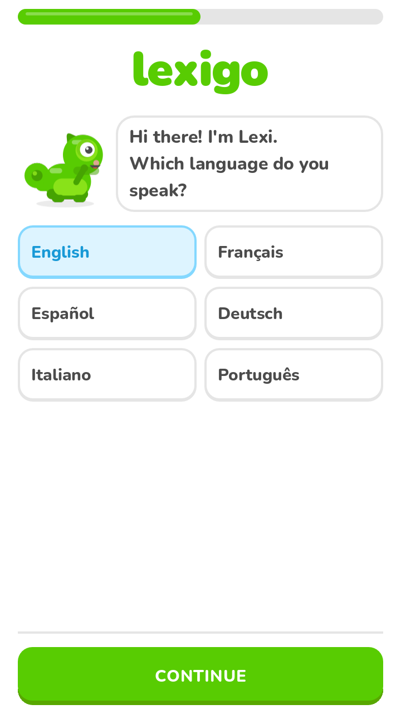
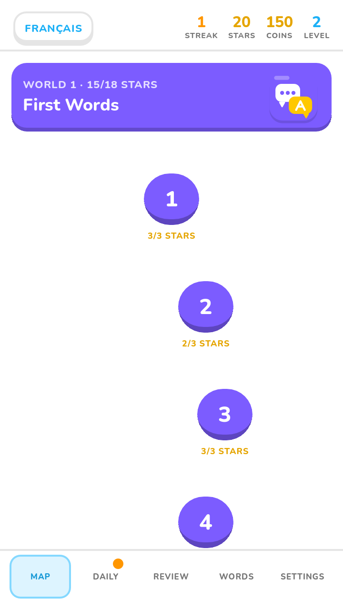
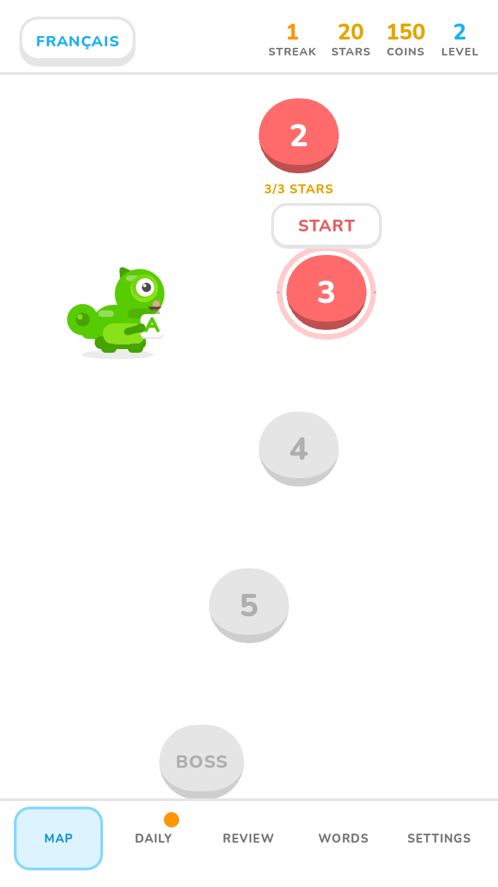
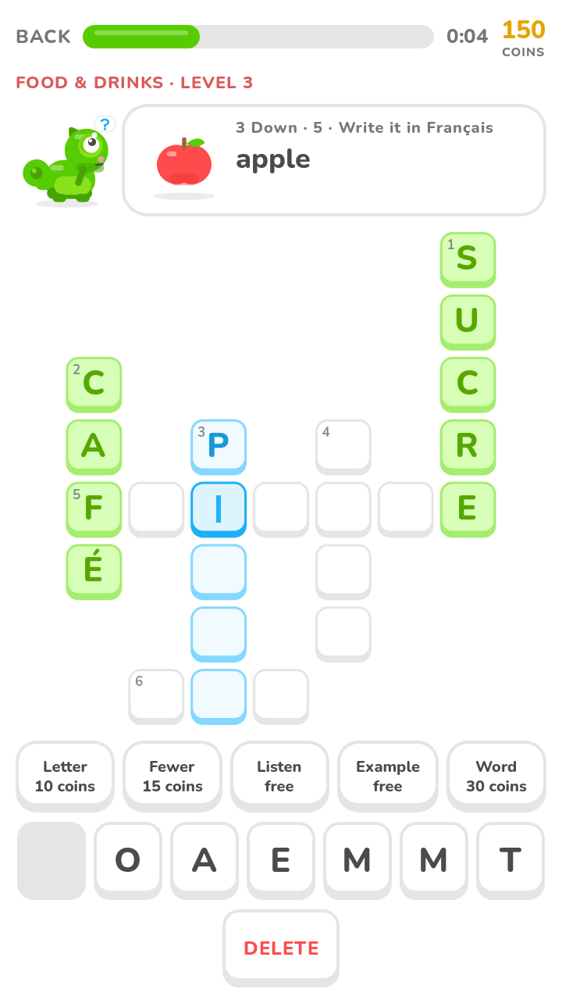
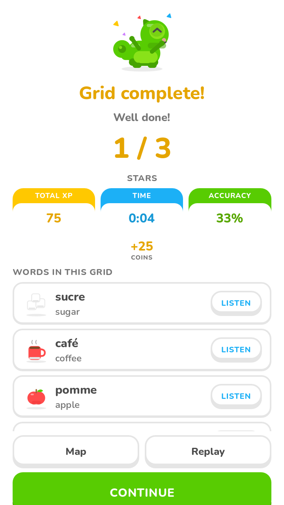
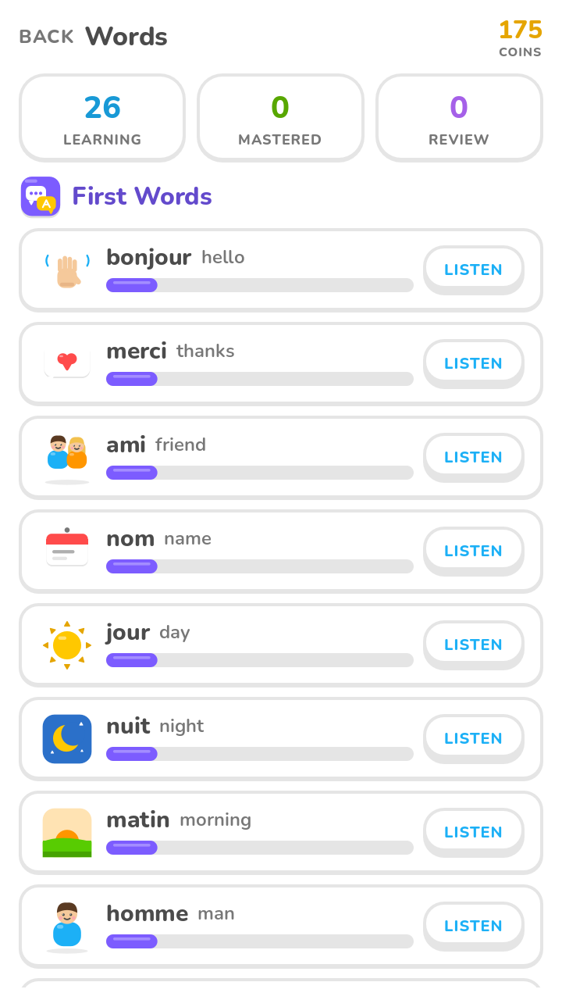

# Lexigo

**Learn languages, one crossword at a time.**
A mobile-first crossword adventure built with **Godot 4.7**.
Application id: `com.mardev.Lexigo`.

You get a clue in the language you speak (🍎 *apple*) and write the answer in the
language you are learning (**POMME**, **MANZANA**, **APFEL**…). The grids are themed
worlds. Words you have solved come back in spaced-repetition review grids until you
remember them for good.

## Features

| | |
|---|---|
| 🌍 **8 themed worlds** | First Words, Food, Animals, Home, City & Travel, Body, Nature, Colors & Clothes. 6 levels each, the last one a 👑 boss grid |
| 🗣 **6 languages** | English, French, Spanish, German, Italian, Portuguese. Any one can be the clue language and any other the language you learn (30 pairs) |
| 🧩 **Procedural crosswords** | Every grid is generated from the level's words: compact, fully interlocked, at most 13×13, and the same each time you replay a level |
| 🧠 **Spaced repetition** | Leitner boxes (0.5 → 35 days). A clean solve moves a word up a box; a solve with hints moves it down; a revealed word goes back to box 1. The **Review** grid is built from words that are due |
| 📅 **Daily challenge** | The same grid for everyone each day, drawn from all your unlocked worlds. Bonus coins, plus a 🔥 streak |
| 🔤 **Letter bank** | No full keyboard: only the tiles the current word needs, shuffled, plus 2–3 decoys from the grid's other answers. Used tiles leave an empty slot and come back when you erase |
| 💡 **Hints** | Reveal a letter (10 🪙), remove the decoy letters (15 🪙), reveal the word (30 🪙), listen to the word, see an example sentence |
| 🔊 **Pronunciation** | A native speaker's recording from Wikimedia Commons / Lingua Libre when online, otherwise the device's own text-to-speech |
| ✍️ **Accents** | Bank tiles carry the exact accented letter (É, Ñ, Ü…). With a physical keyboard, `E` is accepted for `É` unless *strict accents* is on |
| ✨ **Polish** | Lexi reacts to every answer; slide-up feedback strips; letter tiles that bounce and glow; confetti; stars that land one by one; generated sound effects; vibration |
| 📚 **Word list** | Every word you've met, with its memory strength and pronunciation |
| 🌐 **Works offline** | The vocabulary is bundled with the game. Online features are optional extras and fall back silently |

## Design

Lexigo uses a bright, flat, tactile design language in the style of Duolingo:
solid colours, chunky buttons with a bottom lip, the rounded Nunito typeface, and
illustrations built only from rounded rectangles, circles and rounded triangles.
Every asset is original: **Lexi the chameleon** is the mascot, every one of the
**160 words has its own illustration** (no emoji), and there are 8 world badges,
the app icon, adaptive launcher icons and a Play Store feature graphic. The
interface itself uses words, not icons. Tokens, components and the research behind them are in
[docs/DESIGN.md](docs/DESIGN.md). The art is generated by `tools/art/make_art.py` (mascot, badges, store art) and
`tools/art/make_words.py` (word illustrations).

## Research summary: what makes this kind of game work

* **Recall beats recognition.** Building the answer letter by letter, as a crossword makes you do, builds more active recall than tapping one answer out of several choices. Lexigo's letter bank keeps input fast on a phone, and its decoy letters keep you spelling rather than just unscrambling.
* **Spaced repetition decides what you see.** The best vocabulary-crossword apps (Cranki, Vocabulary Builder with SM-2) let the review schedule choose which words appear, so Lexigo has a dedicated review grid and recap words in each level.
* **Sound.** crosswort plays a word's pronunciation from its clue, so you learn how it sounds as well as how it's spelled. Lexigo says each word aloud when you solve it, and has a free 🔊 hint.
* **Words in context.** Showing an example sentence with the word blanked out ("Je mange une ＿＿＿") gives a harder, more meaningful review. That is the 📝 hint, using Tatoeba.
* **Retention loops from top word games** (Wordscapes, Words of Wonders, NYT Games): daily grids, streaks, levels you unlock one by one, stars, and a soft currency for hints with no paywall.

## Free APIs used (optional, online)

| Service | Used for | Licence |
|---|---|---|
| [Tatoeba](https://tatoeba.org) `api_v0/search` | Example sentences and their translations | CC BY 2.0 FR |
| [Wiktionary](https://en.wiktionary.org) API (`prop=images`) | Finding the pronunciation file for a word | CC BY-SA |
| [Wikimedia Commons](https://commons.wikimedia.org) API (`imageinfo`) | Downloading native-speaker recordings (Lingua Libre) | CC BY-SA |
| Device text-to-speech (`DisplayServer.tts_*`) | Offline pronunciation | — |

Credit for all of these is shown in **Settings → Credits**. Requests carry a
descriptive `User-Agent`, as Wikimedia requires. You can turn every online feature off in Settings.

## Project layout

```
Lexigo/
├── project.godot            # Godot 4.7, GL Compatibility, portrait 720×1280 (expand)
├── export_presets.cfg       # Android (.aab), iOS, Web/PWA — all com.mardev.Lexigo
├── data/vocab.json          # 8 worlds × 20 words × 6 languages
├── assets/art/              # mascot, world badges, 160 word illustrations, app icon (SVG)
├── assets/store/            # launcher icons + Play Store feature graphic (PNG)
├── assets/fonts/            # Nunito (SIL OFL)
├── tools/art/               # art generator, contact sheet, PNG export
├── scenes/main.tscn
├── scripts/
│   ├── main.gd              # navigation, transitions, toasts, confetti, pronunciation
│   ├── core/
│   │   ├── vocab.gd         # (autoload) word data, level word lists, keyboard layouts
│   │   ├── game.gd          # (autoload) save data, coins/XP/stars, streak, spaced repetition
│   │   ├── loc.gd           # (autoload) interface text in 6 languages
│   │   ├── sfx.gd           # (autoload) generated sound effects, text-to-speech, vibration
│   │   ├── online.gd        # (autoload) Tatoeba + Wiktionary/Commons clients
│   │   ├── crossword_generator.gd
│   │   └── puzzle_state.gd  # cursor, typing, answer checking, hints, stars
│   ├── ui/                  # design tokens & components, crossword board, keyboard
│   └── screens/             # onboarding, home map, puzzle, results, words, settings
└── tests/                   # headless test suite
```

## Running

1. Open `Lexigo/project.godot` in Godot **4.7** and press **F5**.
2. Tests (headless):
   ```sh
   godot --headless --path Lexigo res://tests/tests.tscn
   ```
   These check that every script compiles, that all 6 keyboards can type every answer,
   that all 288 levels generate valid grids, a full solve of a puzzle, and the
   spaced-repetition rules.

## Exporting

* **Android:** install the Android build template (*Project → Install Android Build Template*),
  set your keystore under *Editor Settings → Export → Android*, then export the **Android** preset.
  It produces an `.aab` for Google Play (min SDK 24, target SDK 35, permissions: Internet and vibrate).
* **Quick APK for testing (no Android Studio):** the **Android APK** preset uses Godot's prebuilt
  template. Export it unsigned, then sign it, for example with
  `java -jar uber-apk-signer.jar -a Lexigo.apk --ks your.keystore --ksAlias your_alias`.
* **iOS:** fill in your Team ID in the **iOS** preset.
* **Web:** the **Web** preset builds an installable PWA.

## Adding content

Add a world, or more words, to `data/vocab.json`:

```json
["🍎", "apple", "pomme", "manzana", "Apfel", "mela", "maçã"]
```

Translations must be a single word of at least 3 letters. Anything else is skipped
for that language automatically. Run the tests afterwards to check that the grids still generate.

## Roadmap ideas

* Arabic as a clue language, with right-to-left interface support
* More worlds (verbs, numbers, phrases) and CEFR-graded word packs
* Cloud save and leaderboards for the daily grid
* Real recorded voices bundled for offline use; music
* Rewarded ads / hint packs (the 🪙 currency is already in place)

## Screenshots

| Onboarding | Learning path | Current level |
|---|---|---|
|  |  |  |
| **Puzzle** | **Results** | **Words** |
|  |  |  |

To regenerate them (needs a display; on Linux CI use `xvfb-run`):
`godot --path Lexigo --resolution 720x1280 res://tests/shots.tscn -- "$PWD/Lexigo/docs/screenshots"`
